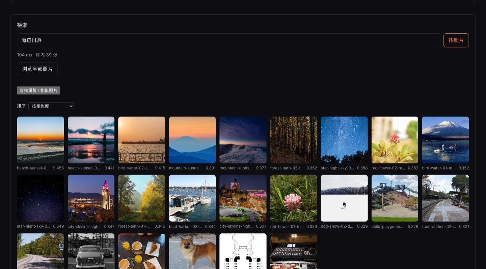

**前端 / 全栈 · Vue 3 × Rust × 本地优先**

写中后台，也写菜单栏小工具和跑在浏览器里的本地 AI。  
标准很简单：做自己会用的东西，并且能说清楚它的边界。

Frontend / full-stack · local-first apps, agent tooling, and tools I actually use.

---

  <b>fstop</b> —— 在浏览器里用一句话搜索本地照片：不上传、不复制、不安装。 <a href="https://xqh-jason.github.io/fstop/">在线试用 →</a>

## 精选

### [fstop](https://github.com/xqh-jason/fstop) TypeScript · Vue · WebGPU · OPFS

本地优先的语义图片搜索。CLIP 跑在浏览器里，照片 0 字节上传、0 份副本，索引存在本机。

### [tide-admin](https://github.com/xqh-jason/tide-admin) + [tide-server](https://github.com/xqh-jason/tide-server) Vue 3 · Rust · Salvo · SeaORM

一套前后端分离的 RBAC 中后台：双凭证认证、接口级授权、写操作审计。

### [focusbar](https://github.com/xqh-jason/focusbar) Rust · Tauri · macOS

菜单栏专注计时器：没有窗口、没有网络请求，常驻约 23 MB。一轮结束自动暂停，等你点开始。

### [dsh-sidebar-delete](https://github.com/xqh-jason/dsh-sidebar-delete) JavaScript · DeepSeek Harness 插件

给 dsh 侧栏补上真正的删除：会话、本地日志、投影缓存、子会话一起清。零运行时依赖，已发 [npm](https://www.npmjs.com/package/dsh-sidebar-delete)。

## 做法

- **小是功能。** FocusBar 只做倒计时：没有窗口、没有网络请求，常驻约 23 MB，解决一件事就停手。
- **依赖是债。** dsh-sidebar-delete 零运行时依赖——一个 Host 路由、四个槽位，装完就能用。
- **写清边界。** fstop 的 README 里有一张 Hard limits 表：先说不支持什么，再谈做得到什么。

## 工具箱

- **前端**：Vue 3 · TypeScript · Vite · Pinia · Element Plus · Tailwind CSS
- **后端**：Rust · Salvo · SeaORM · MySQL
- **桌面与本地 AI**：Tauri · WebGPU · OPFS · sqlite-wasm · CLIP
- **Agent 工具**：DeepSeek Harness 插件 · Skills
- **工程**：pnpm · Turbo · Vitest · GitHub Actions

## 关于

工作里写前端和中后台，工作外把想法做成能装、能点的东西。  
README 里写取舍，Issue 里改 bug。

> 保持热爱，早日躺平。

想聊本地优先、Agent 工具，或者 Vue / Rust，欢迎在任意仓库开 Issue。
